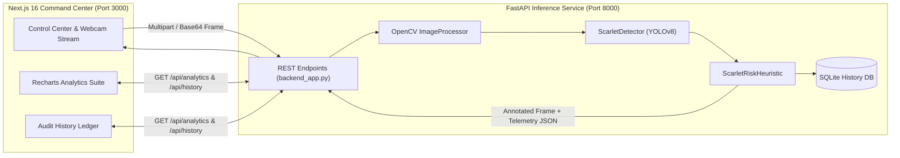

<div align="center">

  <h1>SCARLET</h1>
  <p><strong>AI-Powered Wildfire & Smoke Detection, Telemetry, and Risk Assessment Platform</strong></p>

  <p>
    <a href="https://github.com/m4n1kya/Scarlet/actions/workflows/ci.yml"></a>
    <a href="https://opensource.org/licenses/MIT"></a>
    <a href="https://www.python.org/"></a>
    <a href="https://pytorch.org/"></a>
    <a href="https://github.com/ultralytics/ultralytics"></a>
    <a href="https://fastapi.tiangolo.com/"></a>
    <a href="https://nextjs.org/"></a>
  </p>

  <p>
    <a href="#-overview">Overview</a> •
    <a href="#-system-architecture">Architecture</a> •
    <a href="#-risk-heuristic--dispatch-matrix">Risk Engine</a> •
    <a href="#-getting-started">Getting Started</a> •
    <a href="#-api-reference">API Reference</a> •
    <a href="#-repository-structure">Project Structure</a>
  </p>
</div>

---

## 📌 Overview

**SCARLET** is a production-grade computer vision and emergency telemetry platform designed to detect wildfire and smoke signatures in real time from static imagery, video streams, and live optical feeds.

Built on a decoupled **FastAPI + PyTorch (YOLOv8)** inference backend and a **Next.js** reactive command center, SCARLET goes beyond raw bounding-box prediction. It incorporates a deterministic **Risk Heuristic Engine** that evaluates flame density, normalized viewport burn coverage, and confidence distributions to issue automated operational dispatch directives.

### Key Capabilities

| Capability | Technical Implementation |
| :--- | :--- |
| **Real-Time Object Detection** | Custom-trained **YOLOv8** architecture (`models/best.pt`) detecting `Fire`, `smoke`, and background anomaly (`default`) classes with GPU/CPU auto-selection. |
| **Viewport Burn Area Estimation** | Computes normalized bounding-box coverage (`xyxyn`) to quantify the exact percentage of the camera viewport actively engulfed in flames (`fire_area_est`). |
| **Heuristic Hazard Classification** | Multi-factor evaluation via [`ScarletRiskHeuristic`](src/risk/heuristic.py) categorizing scenes into `LOW`, `MODERATE`, `HIGH`, or `CRITICAL` hazard states. |
| **Automated Dispatch Directives** | Translates hazard classifications directly into emergency response protocols (`NO FIRE DETECTED`, `INVESTIGATE`, `DEPLOY UNITS`, `EVACUATE`). |
| **Sub-Second Telemetry Pipeline** | Adaptive high-resolution frame downscaling (`max_dim = 1280`) prior to OpenCV JPEG encoding and Base64 serialization for minimal network latency. |
| **Historical Analytics & Audit Ledger** | Embedded SQLite persistence ([`DetectionHistory`](src/storage/history.py)) powering interactive Area, Composed, Radar, and Donut visualizations. |

---

## 🏗 System Architecture

SCARLET separates compute-intensive neural network inference from the operator UI through a stateless REST boundary backed by persistent telemetry storage:



---

## 🚨 Risk Heuristic & Dispatch Matrix

Raw bounding boxes are insufficient for automated emergency triage. [`ScarletRiskHeuristic`](src/risk/heuristic.py) correlates detection counts, confidence thresholds, and temporal persistence to assign an actionable hazard tier:

| Risk Level | Image Trigger Criteria | Video Trigger Criteria | Dispatch Directive | Indicator |
| :--- | :--- | :--- | :--- | :--- |
| **LOW** | `total_detections == 0` or `max_confidence < 0.15` | `0` frames with detections | `NO FIRE DETECTED` | `#22c55e` (Green) |
| **MODERATE** | `total_detections <= 3` and `max_confidence < 0.50`, or smoke-only (`fire_count == 0`) | `< 20%` of frames contain detections | `INVESTIGATE` | `#f59e0b` (Amber) |
| **HIGH** | (`fire_count > 0` and `max_confidence >= 0.50`) or `total_detections > 3` | `>= 20%` of frames contain active fire signatures | `DEPLOY UNITS` | `#f97316` (Orange) |
| **CRITICAL** | `fire_count >= 5` and `avg_confidence >= 0.60` | `>= 50%` of frames contain fire with `avg_confidence >= 0.50` | `EVACUATE` | `#ef4444` (Crimson) |

---

## 🚀 Getting Started

### Prerequisites

- **Python** `3.11+` (with `pip` and `venv`)
- **Node.js** `18.18+` or `20+` (with `npm`)
- *(Optional)* **NVIDIA CUDA GPU** for hardware-accelerated PyTorch inference

### Option 1: Local Development Setup

#### 1. Clone the Repository
```bash
git clone https://github.com/m4n1kya/Scarlet.git
cd Scarlet
```

#### 2. Configure & Launch the FastAPI Backend
```bash
# Create and activate a virtual environment
python -m venv .venv

# Windows (PowerShell)
.\.venv\Scripts\Activate.ps1
# macOS / Linux
source .venv/bin/activate

# Install Python dependencies
pip install -r requirements.txt

# Start the inference server on http://localhost:8000
uvicorn backend_app:app --reload --host 0.0.0.0 --port 8000
```

#### 3. Launch the Next.js Frontend
Open a second terminal at the repository root:
```bash
cd frontend
npm install
npm run dev
```
Navigate to **`http://localhost:3000`** to access the SCARLET Command Center.

### Option 2: Docker Compose Deployment

Spin up both the backend API and frontend web client in isolated containers:
```bash
docker compose up --build -d
```

### Environment Variables

Copy `.env.example` to `.env` in the project root to customize runtime thresholds:

| Variable | Default | Description |
| :--- | :--- | :--- |
| `SCARLET_CONFIDENCE` | `0.25` | Minimum YOLOv8 detection confidence threshold (`0.0` – `1.0`). |
| `SCARLET_IOU` | `0.45` | Non-Maximum Suppression (NMS) Intersection-over-Union threshold. |
| `SCARLET_DEVICE` | `auto` | Compute target (`auto`, `cuda`, or `cpu`). |
| `SCARLET_OUTPUT_DIR` | `outputs` | Directory for SQLite history (`scarlet_history.db`) and exports. |

---

## 📡 API Reference

When the backend is running, interactive OpenAPI (Swagger) documentation is available at `http://localhost:8000/docs`.

| Method | Endpoint | Description |
| :--- | :--- | :--- |
| `GET` | `/` | Health check endpoint returning service status. |
| `GET` | `/api/system-info` | Returns active compute device (`cuda`/`cpu`), model load state, and class map. |
| `POST` | `/api/detect/image` | Runs YOLOv8 inference on a multipart `file` or `image_base64` frame. |
| `GET` | `/api/analytics` | Returns aggregated timeline series, class radar metrics, and risk distribution. |
| `GET` | `/api/history` | Fetches recent detection records (`?limit=100`) from SQLite storage. |
| `DELETE` | `/api/history` | Clears all stored detection records. |

<details>
<summary><strong>Example Response: <code>POST /api/detect/image</code></strong></summary>

```json
{
  "fire_count": 3,
  "smoke_count": 2,
  "default_count": 0,
  "total_detections": 5,
  "max_confidence": 0.89,
  "avg_confidence": 0.76,
  "risk_level": "HIGH",
  "risk_description": "High risk. Confirmed presence of fire or significant smoke.",
  "annotated_image_base64": "data:image/jpeg;base64,/9j/4AAQSkZJRgABAQ...",
  "inference_time_ms": 42.18,
  "device": "cuda",
  "fire_area_est": 14.6,
  "dispatch_status": "DEPLOY UNITS"
}
```
</details>

---

## 📂 Repository Structure

```text
SCARLET/
├── .github/
│   ├── ISSUE_TEMPLATE/          # Bug report & feature request templates
│   ├── workflows/ci.yml         # Automated Pytest & Next.js build CI pipeline
│   ├── PULL_REQUEST_TEMPLATE.md # Standard PR checklist
│   └── dependabot.yml           # Automated dependency security scanning
├── assets/
│   ├── docs/banner.jpeg         # Project header artwork
│   └── sample_images/           # Reference fire & smoke test imagery
├── data/
│   ├── confusion_matrix.png     # Model evaluation confusion matrix
│   ├── data.yaml                # Dataset class & split specification
│   └── training_results.csv     # Epoch-by-epoch YOLOv8 training metrics
├── docs/
│   └── PROJECT_REPORT.md        # Comprehensive technical report & methodology
├── frontend/                    # Next.js 16 App Router client application
│   ├── public/                  # Static vector assets
│   └── src/
│       ├── app/                 # Routes: Control Center (/), Analytics, History, About
│       └── components/          # Shared UI & WebGL shader components (EvilEye, Navigation)
├── models/
│   └── best.pt                  # Custom-trained YOLOv8s model weights
├── notebooks/                   # Jupyter training & evaluation notebooks
├── src/                         # Core Python package
│   ├── analytics/analyzer.py    # Statistical & chart aggregation utilities
│   ├── detection/               # ScarletDetector YOLOv8 engine & OpenCV processors
│   ├── risk/heuristic.py        # ScarletRiskHeuristic evaluation engine
│   ├── storage/history.py       # SQLite DetectionHistory persistence layer
│   ├── utils/export.py          # CSV/JSON report export helpers
│   └── config.py                # Environment-aware ScarletConfig dataclass
├── tests/                       # Pytest unit & integration test suite
├── Dockerfile                   # Container image definition for API deployment
├── Makefile                     # Developer workflow automation targets
├── backend_app.py               # FastAPI application entrypoint
├── docker-compose.yml           # Full-stack multi-container orchestration
├── pyproject.toml               # PEP 621 project metadata, Ruff & Pytest config
└── requirements.txt             # Python runtime dependencies
```

---

## 🧪 Testing & Quality Assurance

Run the automated test suite covering detector initialization, risk heuristic boundaries, SQLite CRUD operations, and analytics aggregation:

```bash
pytest tests/ -v
```

---

## 🤝 Contributing & Governance

Contributions, issues, and feature requests are welcome! Please review our community documents before submitting a pull request:

- [Contributing Guidelines](CONTRIBUTING.md)
- [Code of Conduct](CODE_OF_CONDUCT.md)
- [Security Policy](SECURITY.md)
- [Changelog](CHANGELOG.md)

---

## 📄 License & Acknowledgments

- **License:** Distributed under the [MIT License](LICENSE).
- **Object Detection Engine:** Powered by [Ultralytics YOLOv8](https://github.com/ultralytics/ultralytics).
- **Training Dataset:** Derived from the [Roboflow `fire-wrpgm` v8 Dataset](https://universe.roboflow.com/custom-thxhn/fire-wrpgm/dataset/8) (CC BY 4.0).

<div align="center">
  <br />
  <p>Engineered by <a href="https://github.com/m4n1kya"><strong>Manikya Nariyal</strong></a></p>
</div>
